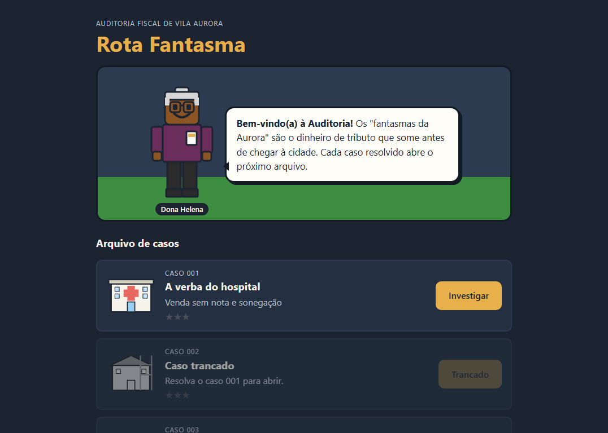
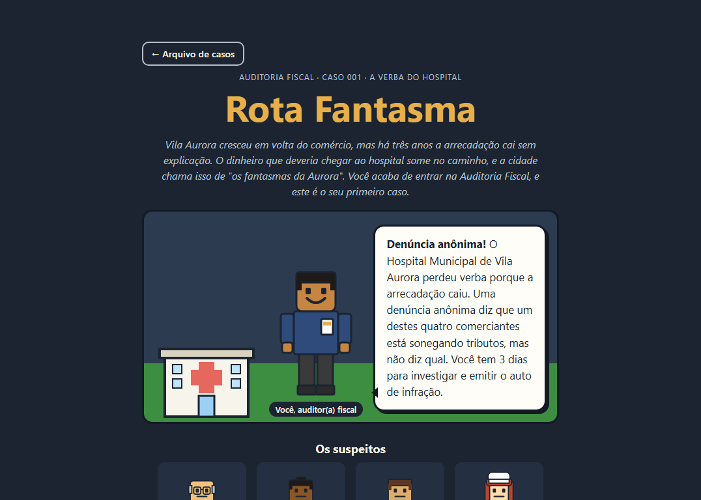
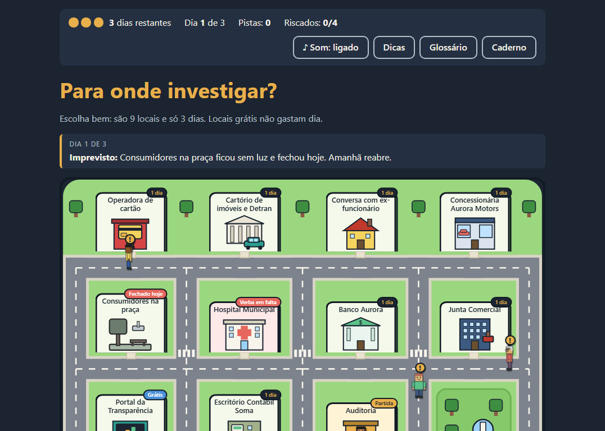
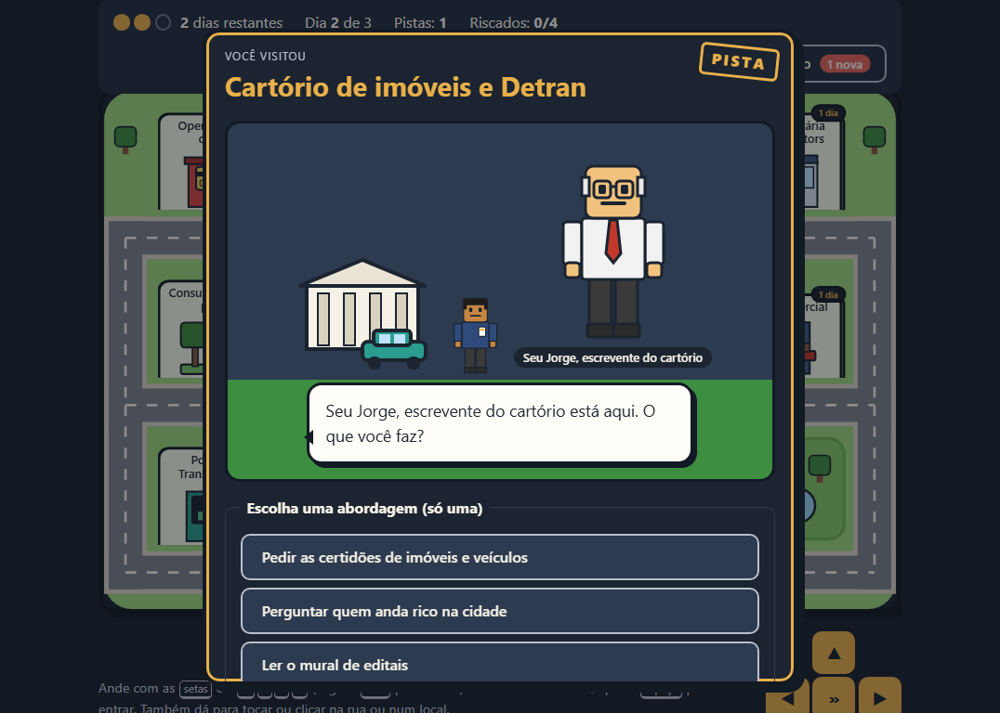
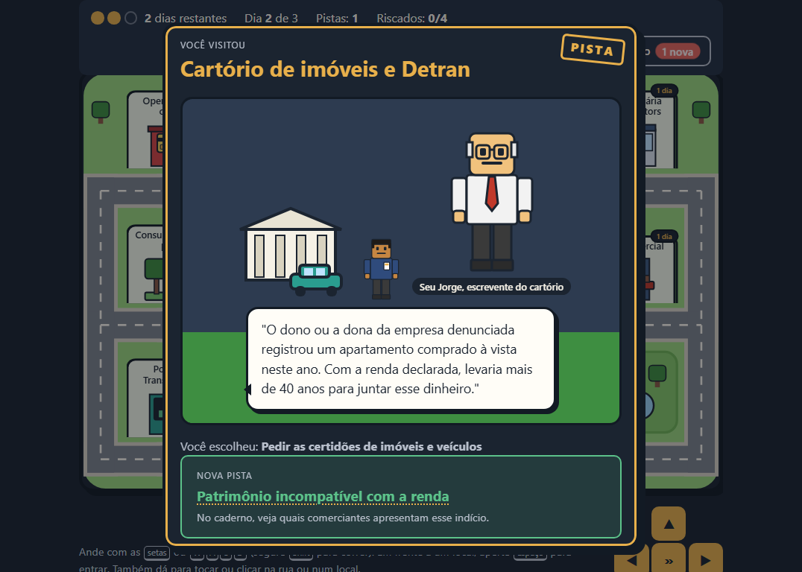
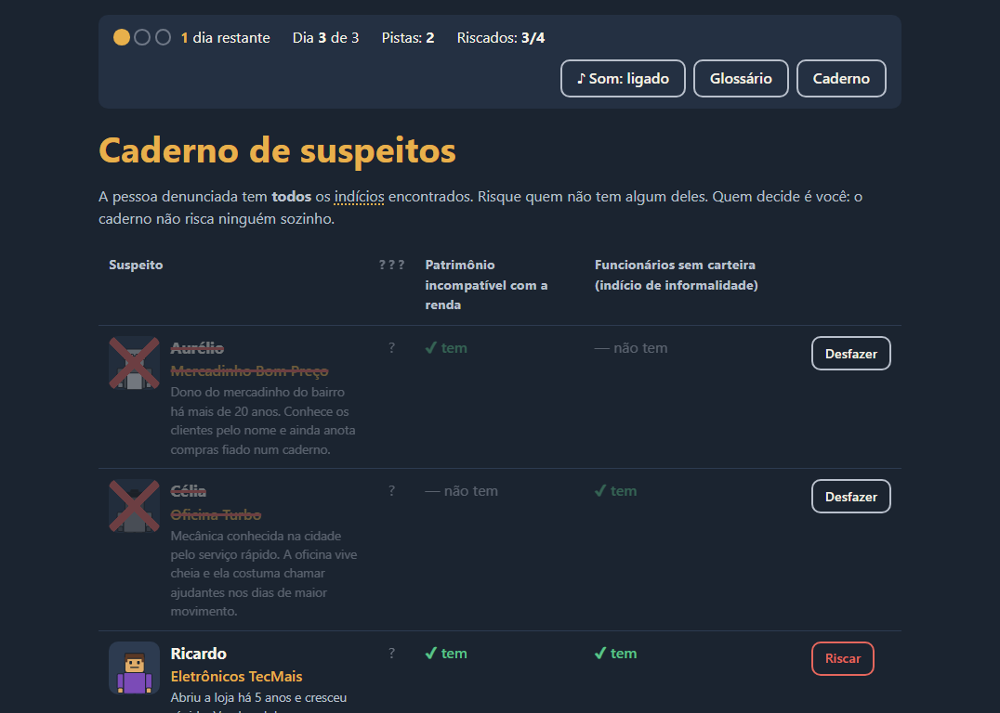
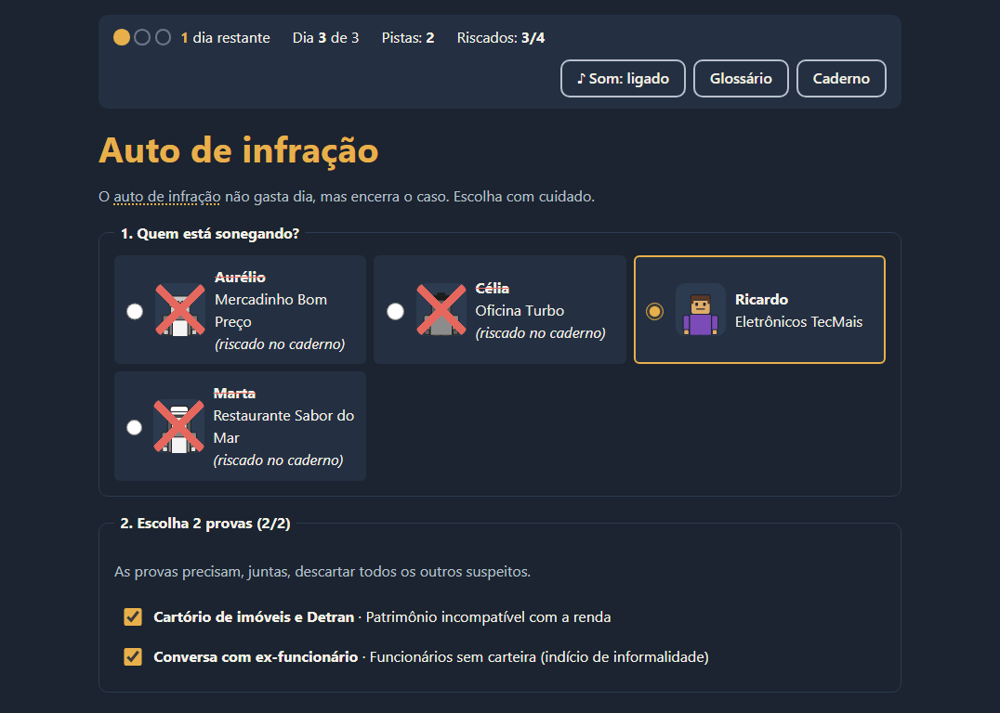

# GDD: Rota Fantasma

> Game Design Document do trabalho da NP2 (T2) de Tecnologia e Desenvolvimento de Jogos Digitais,
> projeto de extensão **EducaJogo Fiscal**. A estrutura segue a seção 6 do enunciado. Personagens,
> empresas e valores do jogo são **fictícios**.

## 1. Identificação

| Campo | Informação |
|---|---|
| Projeto | **Rota Fantasma**: jogo de investigação fiscal |
| Integrante | **Pollyanna Melo** |
| Curso | Sistemas de Informação |
| Disciplina | Tecnologia e Desenvolvimento de Jogos Digitais, 2026.2 |
| Instituição | Universidade Christus (Unichristus) |
| Projeto de extensão | EducaJogo Fiscal, com o NAF da Unichristus e a Receita Federal do Brasil |
| Proposta de aplicação | Jogo proposto ao **NAF da Unichristus** para que os alunos de **Ciências Contábeis da Universidade Christus**, como extensionistas do NAF, o apliquem em ações de educação fiscal com estudantes do Ensino Médio |
| Jogo publicado | <https://pollymelo.github.io/Tecnologia-e-Desenvolvimento-de-Jogos-Digitais/> |
| Código-fonte e histórico | <https://github.com/pollymelo/Tecnologia-e-Desenvolvimento-de-Jogos-Digitais> |

## 2. Problema educativo

Muitos estudantes não relacionam a sonegação com a vida real. Comprar "sem nota" ou deixar de
recolher tributos parece um crime sem vítima. Eles também não percebem que:
- **o tributo já está no preço** do lanche, da roupa e do celular;
- é esse dinheiro que financia o hospital, a creche, a iluminação e a biblioteca da cidade;
- a fiscalização depende de **provas**, e não de suspeitas: acusar sem prova também causa dano.

**Por que é relevante:** é o desafio central do EducaJogo Fiscal: ajudar jovens a compreender
tributos, cidadania fiscal, o uso dos recursos públicos e as consequências para a sociedade. O jogo
trabalha quatro das linhas temáticas do enunciado:
- função social dos tributos;
- sonegação e suas consequências;
- cidadania fiscal e controle social;
- consumo consciente e documentos fiscais.

## 3. Público-alvo

- **Estudantes do Ensino Médio, de 15 a 18 anos**, sem conhecimento prévio de tributos.
- **Linguagem:** situações do dia a dia (lanche, loja, celular, praça) e frases curtas. Termos técnicos
  (auto de infração, indício, nota fria, IPTU, dívida ativa) aparecem sublinhados e abrem um glossário.
- **Dificuldade:**
  - o caso 001 é o mais simples e tem tutorial;
  - os casos seguintes acrescentam temas (nota fria, IPTU, cadeia da nota fiscal) e são destravados
    em sequência;
  - o modo desafio sorteia o culpado para quem quer jogar de novo.
- **Mediação:** pensado para jogar em duplas, com um mediador do NAF ou professor (seção 19).

## 4. Objetivo de aprendizagem

Ao jogar, o estudante deve compreender, perceber ou refletir que:

1. **Função social do tributo:** a arrecadação que falta é a verba que o hospital, a creche, a praça
   ou a biblioteca deixam de receber.
2. **Indício, prova e boato são coisas diferentes:** suspeita e boato não autuam ninguém; documento
   oficial e testemunho direto, sim.
3. **Fiscalização exige fundamentação:** provas que não diferenciam o responsável anulam o auto.
4. **Responsabilidade:** acusar a pessoa errada prejudica um inocente e deixa o sonegador impune.
5. **Práticas de sonegação:** venda sem nota, nota fria, empresa de fachada, "laranja", imóvel
   declarado menor e maquininha em nome de outra empresa.
6. **Cidadania fiscal:** o consumidor pode pedir e conferir a nota fiscal, e qualquer pessoa pode
   consultar o Portal da Transparência.
7. **Priorização:** a fiscalização tem prazo e custo, e nem todo lugar ajuda a resolver o caso.

## 5. Conceito do jogo

Em **Vila Aurora**, uma cidade fictícia que cresceu em volta do comércio, a arrecadação cai há anos, e
o dinheiro que deveria chegar aos serviços públicos "some no caminho". A cidade chama isso de
**"os fantasmas da Aurora"**.
- O jogador é um(a) **auditor(a) fiscal novato(a)**.
- Em cada caso, uma denúncia anônima diz que um entre quatro comerciantes sonega, mas não diz qual.
- Em **3 dias**, o jogador anda pelo mapa, entra nos locais, escolhe como investigar, ouve os
  moradores, risca suspeitos no caderno e emite um **auto de infração** com duas provas.

**O título:** todo tributo percorre uma **rota**, do caixa da loja ao serviço público. O dinheiro
sonegado sai dessa rota e vira um **fantasma**: existiu, mas nunca chega ao destino.

**Diferencial:**
- **O conceito fiscal é a regra do jogo, não um texto ao lado dela.** Para vencer, o jogador precisa
  agir como a fiscalização age: buscar o documento certo, desconfiar de boatos, separar o
  responsável dos outros suspeitos e cumprir o prazo.
- **Errar ensina:** cada um dos quatro desfechos explica o acerto ou o erro.
- **O resultado mostra para onde vai o dinheiro recuperado:** remédios do hospital, a obra da creche,
  a luz da praça, os livros da biblioteca.

**Inspiração de gênero:** jogos de detetive e perseguição por pistas, como a série *Carmen Sandiego*:
o jogador viaja entre locais coletando pistas até identificar o culpado. Todos os personagens, nomes e
artes do Rota Fantasma são originais.

Lore completa: [lore.md](lore.md).

## 6. Gênero e plataforma

- **Gênero:** investigação e dedução (detetive), com exploração de mapa e tomada de decisão.
- **Por que esse gênero:** a fiscalização tributária *é* uma investigação: coletar indícios, cruzar
  informações e fundamentar uma acusação. O gênero põe o jogador no papel de quem decide e arca com
  as consequências.
- **Plataforma:** **navegador (Web)**, em computador, tablet ou celular, sem instalação. Joga-se
  com teclado, mouse ou toque.

## 7. Tecnologia e justificativa técnica

| Item | Escolha |
|---|---|
| Linguagem | **TypeScript** (JavaScript com tipos) |
| Interface | **HTML + CSS** e **SVG** (toda a arte é desenhada em código) |
| Ferramenta de build | **Vite** (template vanilla-ts), sem engine e sem framework de interface |
| Animação e som | `requestAnimationFrame`, **Web Animations API** e **Web Audio API** (efeitos sintetizados, sem arquivos de áudio) |
| Testes | **Vitest** com happy-dom (124 testes automáticos de regras, telas e mapa) |
| Versionamento e publicação | **Git/GitHub**; **GitHub Actions** testa e publica no **GitHub Pages** a cada envio |

**Justificativa:**
- **Público e aplicação:** escolas costumam ter computadores antigos, sem permissão para instalar
  programas. Um jogo Web abre em qualquer navegador, sem conta e sem licença, e o NAF só precisa
  passar um link.
- **Escopo:** o jogo é feito de telas, textos, um mapa 2D e decisões. Isso não exige física nem 3D,
  então HTML, CSS e SVG bastam, e o jogo fica leve (cerca de 60 KB comprimidos, incluindo os 7 casos).
- **Continuidade pelo NAF:** os casos ficam em **arquivos JSON**, separados do código. Um caso novo
  é criado editando texto, e a validação automática impede publicar caso sem solução.
- **Domínio técnico:** as regras são funções puras e testáveis, separadas da interface (seção 18.1).

**Limitações da escolha:**
- precisa de internet para abrir o jogo;
- no celular, o mapa fica pequeno;
- o progresso fica salvo só no navegador de cada aparelho.

As três estão detalhadas na seção 19.9.

## 8. Core gameplay

O que o jogador faz repetidamente, a cada dia da investigação:

```
andar pelo mapa → escolher um local → entrar (gasta 1 dia) → escolher a abordagem lá dentro
→ ler a pista → cruzar no caderno quem tem o indício → riscar suspeitos → ... → acusar com 2 provas
```

A decisão central é **onde gastar cada dia e como investigar em cada lugar**, para juntar duas
provas que só batam com uma pessoa.

## 9. Mecânicas principais

| Mecânica | Ação, regra e consequência |
|---|---|
| **Andar pelo mapa** | O jogador conduz o boneco pelas ruas (setas ou W A S D, Shift para correr, direcional na tela ou clique). **Andar não gasta dia** |
| **Entrar num local** | Parado em frente ao prédio, o jogador aperta Espaço ou toca em "Entrar". **Custa 1 dia** (o Portal da Transparência é grátis) |
| **Escolher a abordagem** | Lá dentro há 3 opções, como pedir o documento, conversar com calma ou fazer fofoca. **Só a certa revela o indício.** A errada gasta a visita e explica por que não serve como prova |
| **Moradores** | Três moradores andam pelas ruas. Encostar num deles (ou clicar) traz uma dica de graça, anotada no caderno. Duas falas são verdade e **uma é boato falso**; nenhuma vale como prova |
| **Imprevistos** | A cada partida, um local fica **fechado** no dia 1 e outro no dia 2. Alguns locais só **aparecem no mapa** depois de outra visita (ex.: a casa do sócio-laranja surge depois da Junta Comercial) |
| **Caderno de suspeitos** | Tabela suspeitos × indícios. Cada coluna começa oculta ("?") e se revela quando o indício é encontrado. **O jogador risca quem descartou; o jogo não elimina ninguém sozinho** |
| **Auto de infração** | O jogador escolhe 1 suspeito e 2 provas coletadas (3 no caso 007). **Acusar não gasta dia** |
| **Vidas** | Cada caso tem **3 vidas**. Um auto errado (acusação injusta ou provas que não diferenciam) é **devolvido pela Dona Helena**, que explica onde ele falhou sem revelar o culpado. O jogador perde 1 vida e volta à investigação no mesmo dia, com as pistas que já tem. Só o erro na última vida encerra o caso |

### 9.1 Regras numéricas

| Regra | Valor |
|---|---|
| Casos | **4**, destravados em sequência |
| Prazo de cada caso | **3 dias** |
| Custo de entrar num local | **1 dia** (o Portal da Transparência custa 0) |
| Locais por caso | **9** (até 10 cabem no mapa) |
| Abordagens por local | **3**; só **1** revela a pista |
| Suspeitos por caso | **4** (o culpado tem 3 indícios, a "armadilha" tem 2 e dois inocentes têm 1 cada) |
| Tipos de indício por caso | **3** |
| Provas exigidas no auto | **2** |
| Moradores por caso | **3** (2 verdades e 1 boato falso) |
| Imprevistos por partida | **1 local fechado no dia 1** e **1 no dia 2** |
| Duplas de provas que resolvem | de **6 a 9** por caso (conferido por teste automático) |
| Valores em reais | **ilustrativos e fictícios**, avisados na tela |

### 9.2 Validação da acusação

As duas provas são válidas se:
1. as duas forem indícios que o acusado tem, obtidos com a abordagem certa; **e**
2. juntas, descartarem todos os outros suspeitos.

Escolher um local só de contexto como prova, ou um local visitado com a abordagem errada, anula o auto.

### 9.3 Modos de jogo

| Modo | Como funciona | Para quê |
|---|---|---|
| **História** (padrão) | Culpado fixo em cada caso; segue a lore e as fichas de solução | Primeira partida e aplicação em sala |
| **Desafio** | As combinações de indícios são **sorteadas entre os suspeitos**, mantendo a estrutura do caso, então sempre há solução | Jogar de novo sem que a resposta "vaze" entre colegas |

Os textos das pistas também variam: os locais principais têm versões alternativas, sorteadas a cada
partida, sem mudar o indício revelado.

## 10. Objetivos e condições

**Progressão:** a tela inicial é o **Arquivo de casos**. Só o caso 001 começa aberto, e **resolver um
caso destrava o próximo**. As melhores estrelas de cada caso ficam salvas no navegador.

| Caso | Tema fiscal | Serviço afetado (prédio do meio do mapa) |
|---|---|---|
| 001: A verba do hospital | Venda sem nota e sonegação | Hospital Municipal |
| 002: A empresa fantasma | Nota fria, empresa de fachada e laranja | Obra da Creche Municipal |
| 003: O IPTU esquecido | IPTU e a função social da cidade | Reforma e postes da praça do bairro |
| 004: A nota que ninguém pede | O consumidor e a nota fiscal | Livros da Biblioteca Pública |
| 005: O barato que sai caro | Pirataria, descaminho e consumo consciente | Viatura do Corpo de Bombeiros |
| 006: Serviço sem nota | ISS e a nota fiscal de serviço (5 suspeitos) | Telhado do Ginásio Municipal |
| 007: A obra que nunca terminou | Corrupção e controle social (5 suspeitos, 3 provas, 4 dias) | Ponte do Rio Aurora |

Os casos 001 a 004 formam a **primeira temporada**; os casos 005 a 007, a **segunda**, com dificuldade
crescente: o caso 006 tem cinco suspeitos e só uma combinação de indícios resolve; o caso 007 exige três
provas e dá quatro dias.

**Vitória e derrota:** cada caso termina em um de quatro desfechos. Os desfechos de erro (auto anulado e
acusação injusta) só encerram o caso quando o jogador erra na **última vida**; antes disso, o auto volta
para ser corrigido.

| Situação | Desfecho | O que ensina |
|---|---|---|
| Suspeito certo e duas provas válidas | **Caso resolvido:** o valor recuperado volta ao serviço público | Função social do tributo |
| Suspeito certo, mas provas que não o diferenciam | **Auto anulado** por falta de fundamentação | Fiscalização precisa de prova, não de suspeita |
| Suspeito errado | **Acusação injusta:** um inocente é prejudicado e o sonegador segue impune | Responsabilidade de quem fiscaliza |
| Dias esgotados sem acusação | **Prazo encerrado** | Fiscalização tem custo e prazo |

**Estrelas** (só no caso resolvido):

| Estrela | Critério |
|:-:|---|
| ★ | Resolver com provas válidas |
| ★ | Sobrar pelo menos 1 dia (priorização) |
| ★ | Caderno em ordem: todos os inocentes riscados e o culpado não (raciocínio por eliminação) |

## 11. Feedback ao jogador

| Momento | Como o jogo comunica |
|---|---|
| Dias | Bolinhas no topo e "Dia X de 3". Ao entrar num local, o céu escurece, uma bolinha se apaga e amanhece |
| Perto de um local | O prédio ganha contorno dourado e aparece "Entrar · Espaço" com o custo; se estiver fechado ou já visitado, o motivo |
| Abordagem escolhida | **"Nova pista"** em verde, com o indício, ou **"Sem prova"**, explicando por que a abordagem não serve |
| Pistas novas | O card voa até o botão do caderno, que mostra "N nova(s)" |
| Caderno | As colunas "?" se revelam; suspeitos riscados ficam tachados; "Riscados: N/4" |
| Morador | Balão de fala; o "!" sobre ele vira "✓"; a fala vai para o caderno como **boato** |
| Imprevisto | Faixa "Dia X: imprevisto: [local] [motivo]" e etiqueta "Fechado hoje" no prédio |
| Resultado | Carimbo ("Autuado", "Anulado", "Inocente", "Prazo encerrado") e valor recuperado ou o que continua faltando |
| **Por que deu certo ou errado** | Para cada prova, o indício que aponta e se o acusado o tem; para cada outro suspeito, o que o descarta ou "também tem". Na acusação injusta, quem era o culpado |
| Boatos | No resultado, quais falas dos moradores eram verdade |
| Teste rápido | Placar **antes X/3 → depois Y/3**, com a resposta certa e uma explicação para cada pergunta |
| Som | Passos, porta, noite, pista, carimbo e fanfarra ou duas notas descendo (pode ser desligado) |

## 12. Fluxo de telas

```
Arquivo de casos ──► Briefing do caso ──► Teste rápido (antes, pode pular)
                                                   │
                                                   ▼
                    ┌────────────────────── Mapa de Vila Aurora ◄──────────────┐
                    │      (andar, moradores, imprevistos; tutorial na 1ª vez)  │
                    │                          │ entrar num local                │
                    │                          ▼                                 │
                    │            Card do local: escolher a abordagem ─► pista ───┘
                    │
                    ├──► Caderno de suspeitos (ida e volta)
                    ▼
            Auto de infração ──► Resultado ──► Teste rápido (depois) ──► comparação
                                     │
                                     └──► Próximo caso · Jogar de novo · Arquivo de casos
```

Estados principais da partida (`src/game/state.ts`):
- dias restantes;
- locais visitados e a abordagem escolhida em cada um;
- locais fechados por imprevisto;
- suspeitos riscados;
- resultado.

## 13. Interface

Telas do protótipo implementado (capturas do jogo publicado):

| Tela | Captura |
|---|---|
| Arquivo de casos (progressão) |  |
| Briefing do caso |  |
| Mapa de Vila Aurora, com moradores e imprevisto do dia |  |
| Dentro do local: escolher a abordagem |  |
| Pista revelada |  |
| Caderno de suspeitos |  |
| Auto de infração |  |
| Resultado com a explicação |  |

## 14. Identidade visual e sonora

**Visual:**
- **Bonecos de blocos** (cabeça quadrada, corpo de peças): um visual de brinquedo de montar, próximo
  dos avatares de jogos populares entre jovens. **Todos os personagens são originais**; o jogo não usa
  marca, logotipo nem personagem de outro jogo.
- O boneco tem três vistas: de frente, de costas e de lado. Ele vira para onde anda e caminha com
  pernas e braços balançando.
- **Mapa visto de cima:** ruas com calçada, faixa e faixa de pedestre, e prédios desenhados para cada
  local (banco, cartório, escola, creche, prefeitura...). O prédio do meio muda com o caso.
- **Cores:** fundo azul-escuro, destaque amarelo-dourado, verde para acerto e vermelho para erro.
- **Toda a arte é SVG feito em código** (`src/ui/arte.ts`), sem imagens externas nem direitos de
  terceiros.

**Sonora:** efeitos curtos sintetizados no navegador (Web Audio API), sem músicas nem arquivos de
terceiros. O som pode ser desligado.

**Animação e acessibilidade:**
- Se o sistema pede movimento reduzido, o jogo usa animações suaves, e há um botão para escolher.
- Dá para jogar só com o teclado.
- Botões e personagens têm descrição para leitor de tela.

## 15. Relação gameplay × Educação Fiscal

| O que o jogador faz | O que se pretende que compreenda |
|---|---|
| Cada visita gasta 1 de 3 dias | Fiscalização tem custo e prazo: é preciso priorizar |
| Escolher a abordagem certa dentro do local (documento × fofoca × pressão) | Prova vem de documento oficial ou testemunho direto, obtidos pelo caminho legal (ex.: o banco não entrega extrato sem autorização, por causa do sigilo bancário) |
| Ouvir moradores, sabendo que um mente | Boato não é prova, mesmo quando parece certo |
| Riscar suspeitos no caderno | Raciocínio por eliminação: cruzar informações |
| Acusar com 2 provas (3 no caso 007) que diferenciem o culpado | Acusação precisa de fundamentação; "chute certo" com prova ruim anula o auto |
| Auto devolvido pela chefia, com 3 vidas por caso | Errar faz parte de aprender: a revisão mostra a falha e o jogador corrige o raciocínio, mas cada erro tem custo |
| Arcar com a acusação injusta | Errar também causa dano: responsabilidade da fiscalização |
| Ver para onde vai o dinheiro recuperado | Função social do tributo |
| Consultar o Portal da Transparência (grátis) | Controle social: os gastos públicos podem ser consultados por qualquer pessoa |
| Os temas dos casos (venda sem nota, nota fria, IPTU, nota do consumidor, pirataria, ISS, obra pública) | Práticas de sonegação e de desvio de dinheiro público, e o papel do consumidor e do cidadão na fiscalização |
| Teste rápido antes e depois | Perceber o próprio aprendizado |

### 15.1 Simplificações conceituais (intencionais)

- **Esfera do tributo:**
  - na vida real, a venda de mercadoria sem nota envolve **ICMS (estadual)**;
  - a renda incompatível envolve o **Imposto de Renda (federal)**;
  - o **IPTU** e o **ISS** são municipais;
  - os tributos de importação do caso 005 são federais.

  O jogo reúne tudo sob um único "auditor fiscal" para não sobrecarregar o público. O mediador deve
  comentar isso no debate.
- **Funcionários sem carteira:** é uma irregularidade **trabalhista e previdenciária**, não sonegação
  de imposto em sentido estrito. No caso 001, ela aparece como **indício de informalidade**.
- **Acesso a dados bancários:** no jogo, o banco só fornece dados "com o pedido oficial, com
  autorização". Na vida real, o acesso da fiscalização segue regras legais específicas.
- **Valores:** todos são fictícios.
- **Iluminação pública:** não é uma simplificação, mas um ponto de atenção. A luz dos postes é paga pela
  **COSIP** (cobrada na conta de energia), não pelo IPTU. No caso 003 a praça continua apagada, mas o
  motivo é a obra que nunca levou os postes até lá, e a COSIP aparece no glossário e nas falas.
- **Corrupção (caso 007):** o auditor trabalha junto com o Tribunal de Contas, e o caso segue para o
  Ministério Público. Na vida real, cada órgão tem a sua competência.

### 15.2 Alinhamento com as referências oficiais

O conteúdo do jogo foi conferido com a apostila *Cidadania e Educação Fiscal no Currículo Escolar*
(Receita Federal, 2ª edição, 2025) e com o *Relatório Nacional de Cidadania Fiscal de 2025* (Receita
Federal).

**Conceito de Cidadania Fiscal.** A apostila adota a definição da Portaria RFB nº 214/2022: iniciativas
que ampliam a conscientização sobre a **função socioeconômica dos tributos** e promovem a compreensão
dos **direitos e deveres ligados à tributação** e a **participação ativa do cidadão**. Esse é o eixo do
jogo:
- o dinheiro sonegado aparece como um serviço público que deixou de existir;
- o jogador exerce o papel de quem fiscaliza, com direitos e limites (prova, sigilo bancário).

**Os 15 temas da Matriz Curricular de Educação Fiscal (Receita Federal) no jogo:**

| Tema da Matriz | Como aparece no Rota Fantasma |
|---|---|
| 2. Patrimônio Público | Os prédios-marco (hospital, creche, praça, biblioteca, bombeiros, ginásio, ponte) e o destino do valor recuperado |
| 3. Origem dos Recursos Públicos | O tributo embutido no preço: abertura dos casos e teste rápido |
| 4. Nota Fiscal e Cupom Fiscal | Casos 001 (venda sem nota), 004 ("cupom" que não é documento fiscal, conferido pelo aplicativo) e 006 (nota fiscal de serviço, NFS-e) |
| 7. Direito à Informação | Portal da Transparência grátis e glossário com linguagem simples |
| 10. Controle Social | Portal da Transparência, a campanha dos alunos no caso 004 e a audiência pública do caso 007 |
| 11. Impactos da Corrupção | Caso 007: medição falsa e superfaturamento numa obra pública |
| 12. Consumo Consciente | Caso 005: produto pirata e sem certificação, "o barato que sai caro" |
| 13. Sonegação Fiscal | Tema central dos casos 001 a 006 (venda sem nota, nota fria, empresa de fachada, IPTU, descaminho, ISS) |
| 15. Aduana | Caso 005: a Receita Federal na aduana e o descaminho |
| 5. Tributos e Constituição · 6. Estado Democrático de Direito | De forma indireta: a fiscalização só pune com prova obtida pelo caminho legal |
| 8. Orçamento Público · 9. Políticas Públicas | Parcial: o resultado mostra para onde vai o dinheiro, mas o jogador ainda não decide o orçamento (proposta na seção 17.2) |

Tema **ainda não trabalhado**: 14. CPF. Orçamento Público e Políticas Públicas (8 e 9) aparecem só em
parte e são o assunto do caso 008 proposto na seção 17.2.

**BNCC.** A apostila destaca as competências gerais 1, 6, 7 e 10 para a Educação Fiscal. O jogo mobiliza:
- **competência 1 (conhecimento):** a função social do tributo;
- **competência 2 (pensamento científico):** investigar causas, elaborar e testar hipóteses, no
  caderno e na investigação;
- **competência 7 (argumentação com base em fatos e informações confiáveis):** o auto de infração só
  vale com provas;
- **competência 10 (responsabilidade e cidadania, decisões com princípios éticos):** a acusação
  injusta tem consequência.

Habilidades do Ensino Médio citadas na apostila e ligadas diretamente às mecânicas:

| Habilidade (BNCC) | Mecânica relacionada |
|---|---|
| **EM13CHS103**: elaborar hipóteses, selecionar evidências e compor argumentos | Escolher as duas provas que fundamentam o auto |
| **EM13LP40**: analisar a pós-verdade e as *fake news* e rever crenças quando os fatos as contradisserem | Boatos dos moradores, um deles falso, revelado no resultado |
| **EM13LP27**: engajar-se na solução de problemas da coletividade, participando de campanhas e debates | A campanha "Pediu nota? A cidade agradece" no caso 004 e as perguntas para debate |

Além disso, as Diretrizes Curriculares do Ensino Médio (Resolução CNE/CEB nº 2/2024, citada na
apostila) incluem a educação fiscal entre os temas contemporâneos transversais.

**Metodologias e extensão.** A apostila recomenda:
- **metodologias ativas:** gamificação (cita o jogo de tabuleiro "Pago ou Não?" e as dinâmicas
  "A Ilha" e "O Bairro") e aprendizagem baseada em problemas;
- **concursos escolares de redação, desenhos, vídeos, memes e jogos digitais**;
- a integração escola–universidade **pela parceria com o NAF e projetos de extensão** (Resolução
  CNE/CES nº 7/2018).

O Rota Fantasma é um jogo digital de **aprendizagem baseada em problema** (resolver um caso) pensado
para ser mediado pelo NAF (seção 19).

**O NAF.** Segundo a apostila, o NAF é um programa de Cidadania Fiscal da Receita Federal em
cooperação com instituições de ensino. Ele leva assistência fiscal gratuita a quem precisa e atua em
projetos de educação fiscal e dinâmicas de conscientização tributária. O Relatório 2025 registra:
- cerca de **460 NAF** no país;
- o projeto *Cidadania Fiscal na Extensão Universitária e no Currículo Escolar* no **mapa estratégico
  da Receita Federal de 2024 a 2027**.

Isso sustenta a proposta de aplicação da seção 19.

## 16. Referências pesquisadas

BRASIL. Ministério da Educação. **Base Nacional Comum Curricular**. Brasília, DF: MEC, 2018.
Disponível em: <https://basenacionalcomum.mec.gov.br/>. Competências e habilidades citadas conforme
RECEITA FEDERAL DO BRASIL (2025a).

RECEITA FEDERAL DO BRASIL. **Cidadania e Educação Fiscal no currículo escolar**: conexão à BNCC,
modelos curriculares possíveis (componente, projeto integrador, itinerário formativo, abordagem intra e
transdisciplinar) e modelo de resolução. 2. ed. Brasília, DF: Receita Federal, out. 2025a. Elaboração:
Ana Paula Sacchi Kuhar e Marirone Carvalho Ferreira de Lima. Disponível em:
<https://www.gov.br/receitafederal/pt-br/centrais-de-conteudo/publicacoes/revistas/cidadania-fiscal/cidadania-fiscal-no-curriculo-escolar.pdf/@@download/file>.

RECEITA FEDERAL DO BRASIL. Gestão Nacional de Cidadania Fiscal. **Relatório Nacional de Cidadania
Fiscal de 2025**: Plano Operacional 2025, execução. Brasília, DF: Receita Federal, 2025b. Disponível em:
<https://www.gov.br/receitafederal/pt-br/centrais-de-conteudo/publicacoes/relatorios/cidadania-fiscal/relatorios-cidadania-fiscal/2025-relatorio-cidadania-fiscal>.

SOMBRA, Tiago. **Aulas da disciplina Tecnologia e Desenvolvimento de Jogos Digitais**. Universidade
Christus, 2026.2. Notas de aula.

UNIVERSIDADE CHRISTUS. **Trabalho NP2: Projeto de Extensão EducaJogo Fiscal**: jogos digitais para
educação fiscal e cidadania. Disciplina Tecnologia e Desenvolvimento de Jogos Digitais, 2026.2.
Enunciado do trabalho.

**Referência de gênero:** BRØDERBUND SOFTWARE. *Where in the World Is Carmen Sandiego?* Jogo eletrônico,
1985. Inspiração para a investigação por pistas; nenhum personagem, nome ou arte foi reproduzido.

## 17. Escopo da NP2

### 17.1 Escopo inicial (implementado e funcionando no protótipo)

- 7 casos completos e jogáveis do início ao resultado, em duas temporadas, destravados em sequência;
- mapa com movimentação do boneco, escolhas dentro dos locais, moradores e imprevistos;
- caderno, auto de infração, 4 desfechos com explicação, estrelas, modo desafio e glossário;
- tutorial, teste rápido antes e depois, som e animações;
- publicação Web automática.

### 17.2 Propostas futuras de melhoria

O protótipo da NP2 é um escopo inicial. Para as próximas versões, pretende-se incluir:

**Aplicação em sala e uso pelo NAF**
- **Painel do mediador:** reunir o placar do teste rápido de todas as duplas da turma, sem identificar
  os estudantes, no lugar da anotação à mão.
- **Funcionar sem internet:** transformar o jogo em aplicativo instalável (PWA), para escolas sem
  conexão. Hoje isso depende de um servidor local (seção 19.5).
- **Editor de casos para o NAF:** um formulário para criar casos novos sem editar o arquivo JSON à mão.
- **Ranking e contas de jogador:** exigem servidor e cuidado com dados de estudantes menores de
  idade (LGPD).

**Experiência de jogo**
- **Câmera que acompanha o boneco no celular:** ampliar o mapa e rolar junto com o personagem,
  para os nomes dos prédios ficarem legíveis em telas pequenas.
- **"Horas do dia" ao andar:** caminhadas longas gastariam parte do dia, como desafio opcional para
  quem já domina o jogo.
- **Leitura dos textos em voz alta:** acessibilidade para estudantes com dificuldade de leitura ou
  baixa visão.

**Conteúdo de educação fiscal**
- **Orçamento público:** depois de resolver o caso, o jogador decide como distribuir o valor
  recuperado entre hospital, escola e praça, e vê as consequências. Isso cobriria a linha temática
  "Orçamento público e prioridades" do enunciado, que o protótipo ainda não trabalha.
- **Nível avançado com a esfera correta de cada tributo** (ICMS estadual, Imposto de Renda federal,
  ISS e IPTU municipais), retirando a simplificação da seção 15.1.

**Mais locais de investigação (órgãos públicos)**

| Ideia | Esforço | O que muda |
|---|---|---|
| Renomear locais para órgãos reais (Sefaz, Receita Federal, Procon etc.) | Baixo | Só os textos no JSON. Alguns já existem: Secretaria da Fazenda, Procon, Junta Comercial e Prefeitura |
| Força-tarefa entre órgãos como enredo | Baixo | Briefing e textos das pistas |
| Novos locais: Detran, Secretaria Municipal de Finanças, Tribunal de Contas, unidade da Receita Federal | **Feito** (casos 005 a 007) | Novas entradas no JSON. A lógica de visitar, escolher a abordagem e coletar a pista já funciona para qualquer local. Acima de 10 locais por caso, o mapa precisa crescer (esforço médio) |
| Explicação de cada órgão ao visitar: o que ele fiscaliza e de que esfera é (municipal, estadual ou federal) | Baixo | Um campo de texto a mais por local. Também reduz a simplificação da seção 15.1 |
| Suspeito prestador de serviço (ISS e nota fiscal de serviço) | **Feito** (caso 006) | Novo tipo de indício. A validação da acusação continua igual, porque compara indícios genéricos |
| Casos com dificuldade crescente (mais suspeitos, menos dias, mais provas exigidas) | **Feito** (casos 006 e 007) | Parâmetros que já existem no JSON (dias, suspeitos, provas exigidas). O arquivo de casos já destrava em sequência |

**Ampliação dos casos (segunda temporada)**

Os casos 005 a 007 já foram **implementados** (seção 10). Eles cobrem temas da Matriz que a primeira
temporada não trabalhava e aumentam a dificuldade aos poucos.

| Caso | Tema da Matriz | Ideia | Locais e órgãos | Situação |
|---|---|---|---|---|
| 005: O barato que sai caro | 12. Consumo Consciente (produto pirata) · 15. Aduana | Uma loja vende eletrônicos falsificados que entram sem passar pela aduana, com prejuízo à arrecadação e risco ao consumidor | Receita Federal (aduana), rodoviária, fabricante, assistência técnica, Procon, laboratório, Correios, escola, Portal | **Implementado** (4 suspeitos, 3 dias) |
| 006: Serviço sem nota | ISS e nota fiscal de serviço | Um prestador de serviço atende muita gente e quase não emite nota | Secretaria Municipal de Finanças, cadastro do ISS, banco, bombeiros (vistoria), contador, cliente, ex-recepcionista, Portal | **Implementado** (5 suspeitos, 3 dias) |
| 007: A obra que nunca terminou | 11. Impactos da Corrupção · 10. Controle Social | A verba da ponte some; o jogador cruza medição, preços, registros e pagamentos | Tribunal de Contas, Câmara Municipal (audiência), fiscal de obras, sindicato, loja de material, banco, Portal | **Implementado** (5 suspeitos, 3 provas, 4 dias) |
| 008: O orçamento da cidade | 8. Orçamento Público · 9. Políticas Públicas | Depois de recuperar os valores dos casos anteriores, o jogador decide como distribuí-los em audiência pública e vê as consequências | Prefeitura, Câmara, conselho municipal, associação de moradores | Proposta: exige uma tela nova (distribuir o orçamento), fora da mecânica de investigação |
| Temporada em outra cidade | Todos | Os mesmos tipos de caso numa cidade portuária ou rural, com outros serviços públicos em jogo | Novo mapa e novos marcos | Variável |

## 18. Divisão de atividades

Trabalho **individual**. Todas as decisões, testes e entregas são de responsabilidade da autora.

| Atividade | Responsável | Como |
|---|---|---|
| Ideia, tema (educação fiscal), público e gênero (investigação inspirada em Carmen Sandiego) | Pollyanna | Concepção própria, com ideação apoiada por IA (seção 18.2) |
| Decisões de design | Pollyanna | Escolheu entre as alternativas propostas e pediu mudanças (lista na seção 18.2) |
| Programação, arte em SVG, testes e publicação | Pollyanna, com IA como assistente de código | Código gerado com IA a partir dos pedidos da autora e conferido por testes automáticos e jogando no navegador |
| Conteúdo dos casos (textos, perguntas, glossário) | Pollyanna, com IA na redação | A autora deu à IA a base e a inspiração do conteúdo: trouxe o design inicial do jogo (mecânicas, caso 001, suspeitos, locais, desfechos e continuidade pelo NAF); fixou a **educação fiscal** como ideia central e o público do Ensino Médio; indicou a referência de *Carmen Sandiego* e o visual de **bonecos de blocos** para aproximar os jovens; pediu a lore depois da orientação do professor; pediu textos que variassem a cada partida; e pediu mais casos e mais opções de visita, escolhendo os temas sugeridos na lore. A IA redigiu os textos a partir dessas diretrizes |
| Teste com jogadores e ajustes | Pollyanna | Ainda precisa de ajustes |
| GDD, ficha de aplicação e apresentação | Pollyanna, com IA na redação | Revisão e adaptação pela autora |

### 18.1 Organização do código (para análise e continuidade)

| Pasta ou arquivo | Responsabilidade |
|---|---|
| `src/game/types.ts` | Tipos do caso: suspeitos, locais, abordagens, moradores |
| `src/game/state.ts` | Estado imutável da partida |
| `src/game/rules.ts` | Regras puras: visitar, escolher a abordagem, validar a acusação, desfechos, estrelas, imprevistos, modo desafio, validação do JSON |
| `src/game/caso.ts` | Carrega e valida os 7 casos e junta o glossário comum |
| `src/data/*.json` | Conteúdo dos casos (editável pelo NAF) |
| `src/ui/app.ts` | Telas e eventos (arquivo de casos, mapa, card, caderno, acusação, resultado) |
| `src/ui/mapa.ts` | Geometria do mapa: ruas, colisão, ajuda na curva, caminho mais curto, rotas dos moradores |
| `src/ui/animacao.ts`, `src/ui/som.ts`, `src/ui/arte.ts` | Animações, efeitos sonoros e desenhos SVG |
| `src/**/*.test.ts` | 134 testes automáticos |
| `scripts/gerar-fichas.mjs` | Gera as fichas de solução a partir dos JSON |
| `.github/workflows/deploy.yml` | Testa, gera o build e publica a cada envio |

**Evidências de evolução:** o histórico de commits no GitHub registra cada etapa, desde o projeto Vite
inicial e o GDD até a campanha com 7 casos.

### 18.2 Uso de IA generativa

| Item | Registro |
|---|---|
| **Ferramentas** | **Claude (Anthropic)**: no chat do claude.ai, na ideação inicial; e no **Claude Code** (extensão do VS Code, modelo Claude Opus 5.5), no desenvolvimento |
| **Finalidade** | Ideação do design; programação em TypeScript, HTML, CSS e SVG; testes automáticos; redação dos textos dos casos, do glossário e das perguntas; documentação (GDD, lore, fichas, roteiro); configuração da publicação |
| **O que foi decisão da autora** | Tema (educação fiscal) e gênero (investigação estilo Carmen Sandiego); visual de bonecos de blocos para aproximar o público jovem; pedido de lore; boneco controlado pelo jogador ("só com clique não parece jogo digital"); entre as alternativas propostas, a escolha de "clique e ele anda", card sobre o tabuleiro, dia e noite e porta que abre; pedido de mais casos e mais opções de visita, escolhendo 3 casos novos, desbloqueio em sequência, escolhas dentro da casa, moradores, imprevistos e mais locais; pedido de revisão dos casos 002 a 004 e escolha de manter a praça apagada explicando a COSIP; pedido de implementar os casos 005 a 007 propostos na seção 17.2; pedido de 3 vidas por caso e escolha de que o auto errado custe 1 vida e o jogador continue investigando; aceite de sugestões como 3 dias, Portal grátis e teste rápido |
| **Como foi validado** | (1) **134 testes automáticos**, que conferem as regras, as telas, o mapa e o conteúdo (todo caso tem solução, nenhuma pista cita o nome do culpado, os boatos falsos continuam falsos no modo desafio); (2) **validação automática dos casos** ao carregar o JSON; (3) **jogo testado no navegador** (Edge) com capturas de tela a cada etapa, o que revelou e corrigiu falhas (ex.: animações desligadas pelo Windows, o morador fugindo antes da conversa); (4) **revisão da autora:** **[descrever: o que jogou, o que leu, o que pediu para mudar]** |
| **Limites e responsabilidade** | O conteúdo fiscal gerado com IA foi simplificado de propósito (seção 15.1) e deve ser revisado com o NAF. A autora é responsável pela entrega e deve saber explicar as regras (`rules.ts`), os casos em JSON e o movimento do boneco (`mapa.ts`) |

**Assets e bibliotecas de terceiros:**
- nenhuma imagem, som ou fonte de terceiros (toda a arte e todo o som são gerados em código);
- bibliotecas abertas usadas só no desenvolvimento: Vite, TypeScript, Vitest e happy-dom.

## 19. Ficha de Aplicação Extensionista

> Como o Rota Fantasma pode ser usado numa ação educativa mediada pelo **NAF da Unichristus**, nas
> iniciativas de Cidadania Fiscal da Receita Federal. O jogo foi proposto ao NAF da Unichristus para que
> os alunos de Ciências Contábeis da Universidade Christus, como extensionistas, o apliquem com estudantes
> do Ensino Médio. Os itens seguem a seção 6.1 do enunciado da NP2.

| Campo | Informação |
|---|---|
| Jogo | Rota Fantasma: <https://pollymelo.github.io/Tecnologia-e-Desenvolvimento-de-Jogos-Digitais/> |
| Código-fonte | <https://github.com/pollymelo/Tecnologia-e-Desenvolvimento-de-Jogos-Digitais> |
| Mediação | Extensionista do NAF da Unichristus (aluno ou aluna de Ciências Contábeis da Universidade Christus) ou professor(a) Tiago Sombra |

### 19.1 Público esperado e faixa etária

- **Estudantes do Ensino Médio, de 15 a 18 anos** (1ª a 3ª série), sem conhecimento prévio de tributos.
- Linguagem do dia a dia (lanche, loja, celular, praça). Termos técnicos (auto de infração, indício,
  nota fria, IPTU, dívida ativa) aparecem sublinhados e abrem um **glossário**.
- Jogo em **duplas**: um controla o boneco e o outro cuida do caderno, e os dois decidem juntos a acusação.

### 19.2 Objetivo educativo da atividade

Levar o estudante a perceber que **o tributo já está no preço do que ele compra** e que a sonegação
tira dinheiro de serviços que ele usa (hospital, creche, iluminação, biblioteca). Ao final, ele deve
conseguir:

1. ligar a arrecadação aos serviços públicos (**função social do tributo**);
2. diferenciar **indício, prova e boato**, e explicar por que punir alguém exige prova;
3. reconhecer práticas de sonegação: venda sem nota, nota fria, empresa de fachada, "laranja" e
   imóvel declarado menor que o real;
4. reconhecer a **nota fiscal como direito do consumidor** e saber conferi-la;
5. saber que os gastos públicos podem ser consultados no **Portal da Transparência** (controle social).

O jogo cobre quatro linhas temáticas do enunciado: função social dos tributos, sonegação e suas
consequências, cidadania fiscal e controle social, e consumo consciente e documentos fiscais.

### 19.3 Duração aproximada

| Formato | Duração | Conteúdo |
|---|---|---|
| **Uma aula** (recomendado para a primeira aplicação) | **50 min** | Caso 001, com teste rápido antes e depois e debate |
| **Duas aulas** | **100 min** | Caso 001 na primeira aula; casos 002 a 004 e debate comparando os temas na segunda |
| **Segunda temporada** | 1 ou 2 aulas | Casos 005 a 007, para turmas que já jogaram a primeira; o 007 (3 provas) funciona bem como desafio final |
| Partida de um caso | 15 a 25 min | Varia com a leitura e as escolhas da dupla |

**Roteiro da aula de 50 minutos:**

| Tempo | Atividade |
|---|---|
| 0–5 min | Abertura com a pergunta disparadora: "No preço de um lanche, quanto é imposto? Para onde ele vai?" |
| 5–8 min | As duplas abrem o link e respondem o **teste rápido (antes)**, com 3 perguntas |
| 8–33 min | Jogam o caso 001. O mediador circula e observa, sem dar respostas |
| 33–43 min | **Debate** com as perguntas da tela de resultado (item 19.8) |
| 43–48 min | **Teste rápido (depois)**. O mediador anota o placar antes → depois de cada dupla |
| 48–50 min | Fechamento: "O que você vai fazer diferente na próxima compra?" |

### 19.4 Equipamentos necessários

- **1 aparelho por dupla:** computador, notebook, tablet ou celular. No computador, joga-se com
  teclado (setas ou W A S D) ou mouse; no celular, com toque e um direcional na tela. Computador ou
  tablet é melhor, porque no celular o mapa fica pequeno.
- **Navegador atualizado** (Chrome, Edge, Firefox ou Safari).
- **Projetor** (recomendado) para a abertura e o debate.
- **Som:** opcional. O jogo tem botão para desligar; em sala, o ideal é jogar sem som ou com fones.

### 19.5 Necessidade de conexão com a Internet

- **Sim, para abrir o jogo.** Ele é um site e carrega pelo link.
- Depois de carregado, o jogo roda inteiro no navegador. Se a internet cair durante a partida, dá para
  continuar, mas **recarregar a página exige conexão de novo**.
- **Sem internet na escola:** um computador com o projeto pode servir o jogo na rede local
  (`npm run build` e um servidor local). Isso exige alguém da equipe e não é uma opção para o mediador
  fazer sozinho.

### 19.6 Contas, licenças, instalações ou dependências

| Para quem | O que precisa |
|---|---|
| **Estudantes e mediador** | **Nada:** sem conta, sem login, sem instalação e sem licença paga. Só o navegador e o link |
| **NAF, para criar ou editar casos** | Editor de texto para os arquivos JSON. Para testar e publicar: Node.js 20 ou mais recente, `npm install` (bibliotecas abertas e gratuitas: Vite, TypeScript, Vitest) e uma conta no GitHub para enviar as alterações; a publicação no link é automática |

**Dados pessoais:** o jogo **não coleta nem envia nenhum dado**. O progresso (casos destravados e
estrelas) fica só no navegador do aparelho. O placar do teste rápido aparece na tela, e o mediador
anota à mão. Isso facilita a aplicação com menores de idade.

### 19.7 Instruções básicas para o mediador

**Antes da aula**
1. Abrir o link no aparelho da escola e testar (conexão, tela, som).
2. Jogar o caso 001 uma vez, de 15 a 20 minutos.
3. Ler a ficha de solução ([docs/fichas-de-solucao.md](fichas-de-solucao.md)). Ela traz o culpado,
   a abordagem certa em cada local, as duplas de provas válidas e quais moradores mentem.
   **Não mostrar aos estudantes.**

**Para iniciar**
1. Cada dupla abre o link. Na tela **Arquivo de casos**, clica em **Investigar** no caso 001 e depois
   em **Começar investigação**.
2. As duplas respondem as 3 perguntas do teste rápido. Dá para pular, mas aí não há placar.
3. A Dona Helena dá 4 dicas de como jogar. Se precisar, o botão **Dicas** reabre o tutorial.

**Durante a partida**
- Não dizer quem é o culpado. Se uma dupla travar por mais de 2 minutos, perguntar: "Quem do caderno
  tem **todos** os indícios que vocês encontraram?"
- Lembrar que **boato de morador não é prova** e que, dentro de cada local, a abordagem escolhida importa.
- Duplas que terminarem antes podem jogar o **modo desafio** (culpado sorteado) ou seguir para o
  caso 002, que se abre ao resolver o 001.

**Entre turmas ou duplas no mesmo aparelho**
- Usar uma **aba anônima** ou limpar os dados do site. Assim o teste rápido e as dicas aparecem de
  novo, e o progresso de uma dupla não abre casos para a próxima.

### 19.8 Questões para discussão depois do uso

**Gerais (servem para qualquer caso):**
1. Quais serviços públicos da sua cidade são pagos com tributos? Qual deles você usou esta semana?
2. Por que uma suspeita, mesmo correta, não basta para punir alguém?
3. Que diferença faz pedir a nota fiscal, para você e para a cidade?
4. Algum morador contou um boato falso? Como vocês decidiram em quem acreditar?
5. O que pode acontecer com um comerciante acusado injustamente?

**Por desfecho:** a tela de resultado mostra duas perguntas específicas. Exemplo do caso 001:

| Desfecho | Perguntas |
|---|---|
| Caso resolvido | Quais serviços públicos da sua cidade são pagos com tributos? Por que pedir nota fiscal ajuda a evitar a sonegação? |
| Auto anulado | Que dupla de provas teria fundamentado a acusação? Por que uma suspeita, mesmo correta, não basta para punir alguém? |
| Acusação injusta | Que consequências uma acusação injusta pode trazer para um comerciante? Que indício faltava para descartar o suspeito acusado? |
| Prazo encerrado | Quais locais trouxeram informação útil e quais não? Como vocês escolheriam os locais se jogassem de novo? |

**Por tema:**

| Caso | Pergunta |
|---|---|
| 002 | O que pode acontecer com quem empresta o nome para abrir uma empresa para outra pessoa? |
| 003 | É justo um imóvel grande pagar o mesmo IPTU que uma casa pequena? |
| 004 | Como garantir que uma campanha de cidadania não vire "caça às bruxas"? |
| 005 | Por que o produto pirata prejudica também quem não comprou nada? |
| 006 | Por que receber por Pix na conta pessoal, sozinho, não prova sonegação? |
| 007 | Que obra do seu bairro você gostaria de acompanhar, e onde encontraria as informações dela? |

**Dica de condução:** comparar uma dupla que resolveu o caso com uma que teve o auto anulado, com a
mesma pergunta "que provas vocês usaram?", costuma render o melhor debate.

### 19.9 Limitações conhecidas e cuidados para aplicação

| Limitação ou risco | Cuidado |
|---|---|
| **Simplificação conceitual:** o jogo reúne tributos de esferas diferentes sob um "auditor fiscal". Na vida real, venda sem nota envolve ICMS (estadual), renda incompatível envolve Imposto de Renda (federal) e IPTU é municipal; "funcionário sem carteira" é irregularidade trabalhista | Comentar no debate (seção 15.1 deste GDD) |
| Precisa de internet para abrir | Testar o link antes; ter a versão local como reserva (item 19.5) |
| **Testado só no Edge** (computador e celular simulado) | Testar o navegador da escola antes da aula |
| No celular, o mapa fica pequeno | Preferir computador ou tablet; no celular, usar a tela deitada |
| O progresso fica salvo no aparelho | Usar aba anônima entre duplas (item 19.7) |
| O placar do teste rápido não é registrado automaticamente | O mediador anota à mão o placar antes → depois de cada dupla |
| Duplas podem copiar a solução umas das outras | Usar o modo desafio, em que o culpado muda a cada partida |
| Estudantes podem associar comerciantes reais à sonegação | Todos os nomes, empresas e valores são fictícios; reforçar isso na abertura |
| Ainda **não foi aplicado com estudantes** | Primeira aplicação com observação (roteiro em [docs/roteiro-teste-jogador.md](roteiro-teste-jogador.md)) e ajustes registrados |

### 19.10 Potencial de uso e adaptação pelo NAF

O NAF pode **criar casos novos sem programar**, editando um arquivo JSON:

1. Copiar um caso existente (`src/data/caso-00X.json`) e trocar suspeitos, locais, falas, perguntas
   e textos do resultado.
2. **Regras que o arquivo precisa seguir:**
   - até 10 locais e 4 moradores;
   - cada local com uma única abordagem que revela a pista;
   - nenhuma pista pode citar o nome de um suspeito.

   Se algo estiver errado, o jogo mostra o erro ao carregar e não abre um caso sem solução.
3. Incluir o caso na lista `src/game/caso.ts`, rodar `npm test` e
   `node scripts/gerar-fichas.mjs` (gera a ficha de solução do caso novo).
4. Ao enviar para o GitHub, o jogo é testado e publicado sozinho no mesmo link.

**Ideias de casos:**
- o ISS de um prestador de serviço;
- contrabando e pirataria;
- um caso baseado numa notícia da cidade da escola, com nomes e valores fictícios.

## Apêndice A: Caso 001 em detalhe

**Briefing:** o Hospital Municipal perdeu verba. Uma denúncia anônima diz que um entre quatro
comerciantes sonega, mas não diz qual. Prazo: 3 dias.

| Suspeito | Vendas no cartão sem nota | Patrimônio incompatível | Funcionários sem carteira |
|---|:-:|:-:|:-:|
| Aurélio (Mercadinho Bom Preço) | | ✔ | |
| Célia (Oficina Turbo) | | | ✔ |
| **Ricardo (Eletrônicos TecMais): culpado** | ✔ | ✔ | ✔ |
| Marta (Restaurante Sabor do Mar): armadilha | ✔ | | ✔ |

| Local | Indício | Abordagem que revela |
|---|---|---|
| Operadora de cartão | Vendas no cartão sem nota | Pedir o relatório de vendas no cartão |
| Cartório de imóveis e Detran | Patrimônio incompatível | Pedir as certidões de imóveis e veículos |
| Conversa com ex-funcionário | Funcionários sem carteira | Conversar com calma, sem pressa |
| Concessionária Aurora Motors | Patrimônio incompatível (testemunho) | Conversar com a vendedora |
| Consumidores na praça | Vendas no cartão sem nota (testemunho) | Ouvir os consumidores |
| Banco Aurora | Contexto: sigilo bancário | Pedir o extrato da empresa denunciada |
| Junta Comercial | Contexto: estar registrado não prova regularidade | Consultar o cadastro das empresas |
| Portal da Transparência (grátis) | Contexto: quanto o hospital deixou de receber | Ver a receita e a verba do hospital |
| Escritório Contábil Soma | Contexto: a sonegação começa no balcão | Perguntar como funciona a declaração |

O patrimônio incompatível é o que separa Ricardo de Marta, então toda dupla de provas válida passa
pelo Cartório ou pela Concessionária. Soluções dos 7 casos: [fichas-de-solucao.md](fichas-de-solucao.md).

## Apêndice B: Detalhes de implementação do movimento e das animações

- **Andar:**
  - o boneco só anda em ruas e calçadas;
  - ao bater na borda, desliza ao longo dela;
  - é puxado para a transversal quando está perto da esquina (ajuda na curva);
  - acelera e freia em cerca de 0,1 s;
  - corre com Shift (1,75×).
- **Caminhada automática:** clicar num local ou na rua faz o boneco seguir o caminho mais curto pelas
  ruas (algoritmo de Dijkstra sobre o grafo das ruas). Uma seta cancela a caminhada.
- **Visita:** caminhada → a porta abre e a casa acende → noite (uma bolinha de dia se apaga) →
  amanhecer → o card da pista vira em 3D → ao guardar, o card voa até o caderno.
- **Moradores:**
  - dão voltas em quarteirões diferentes;
  - param quando são chamados e se viram para o boneco durante a conversa.
